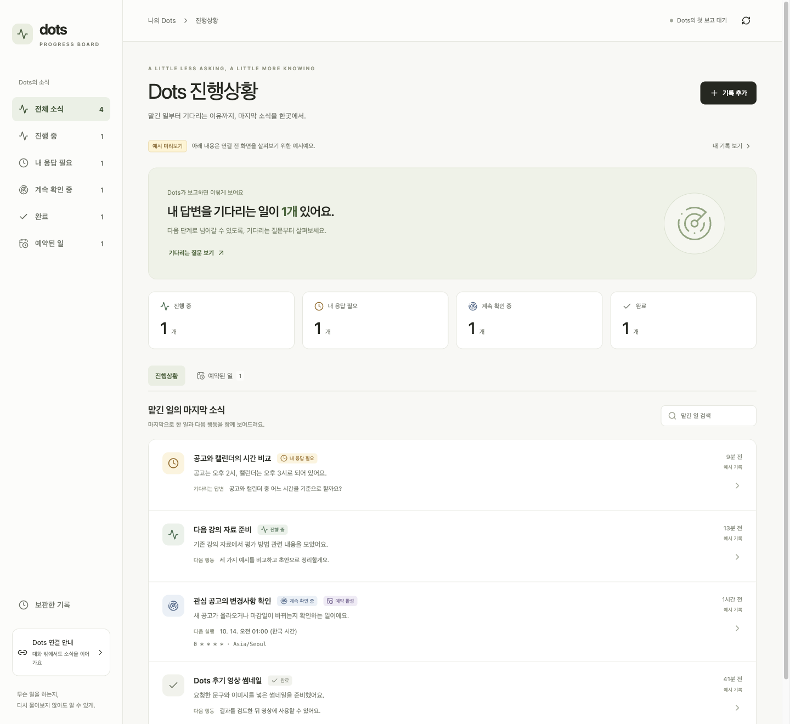

# OpenAI Dots Progress Board

[한국어](README.ko.md)

A personal board for tracking work and recurring schedules you assign while talking with OpenAI Dots. Your connected dot updates the board when work starts, its status changes, it needs a response, or it finishes or stops.

## Screenshot



## What you can see

- Current work, the last reported action, the next action, and results
- Reasons for waiting on your response or an external condition
- Reported information about existing cron jobs and recurring schedules, including recurrence, time zone, whether they are enabled, and the next and most recent execution times, when available
- The last report time and records that have not been updated recently
- Search, manual entries and edits, recent history, archiving, and restoring

The board stores reports sent through `report_activity` and records you enter manually. It does not automatically collect existing conversations or schedules. The four sample entries shown in the interface are not saved to the database.

## Set up your own board

**Deploy a new private Sites instance under your own account.** Each instance has its own storage and plugin. Use your own board address and plugin.

1. Clone or fork this public repository.
2. Open the cloned project in ChatGPT Work or Codex and send this request:

   > Deploy this project as a new private Site under my account. If `.openai/hosting.json` has no `project_id`, create a new Site and save its ID. Set up D1 storage, apply the existing migrations, and prepare the MCP plugin for connection. Do not copy another person's Site ID, data, or credentials.

3. Install or connect the deployed site's plugin in your own ChatGPT account.
4. Select the plugin in your dot's conversation and send the instructions below. You can also find connection guidance under **Dots 연결 안내** in the board.
5. Ask your dot to record one small task, then read the entry back to verify the connection.

The public deployment source's `.openai/hosting.json` does not include a personal Site ID. `.openai/hosting.example.json` provides settings for a new instance. After deploying your own instance, keep its actual `project_id` in that instance's deployment source.

## Copy these instructions to your dot

Connect the board plugin, then copy and send the following instructions to your dot:

```text
From now on, record the start of tasks I assign, progress status changes, waits for a response, completion, and stops on the connected board. Update the same card for the same task, and include the next action, the reason for waiting, and result links. When you create, change, or stop an automation I requested, also record the schedule information and status you actually verified on the board. For recurrence, time zone, whether the automation is enabled, its most recent execution, and its next execution time, use only values you can verify and mark values that are not provided as "Not provided". Exclude casual conversation and sensitive information, and do not guess whether work ran or completed.
```

**Publishing this README on GitHub does not apply these instructions to anyone else's dot. Each user must connect their own board and give the instructions to their dot.** For use across conversations, ask your dot to retain the instructions in its own user instructions and verify that it follows them. [AGENTS.md](AGENTS.md) contains the reporting routine for agents working in this repository, but does not configure other users' dots.

Read existing entries first and reuse one stable `id` for the same outcome. Use `planned` before execution starts, `working` only after it actually starts, `waiting` when a response or dependency is needed, `done` after confirming completion, and `paused` when work is stopped or paused. Include a concrete `waitingFor` when waiting, a `nextStep`, and a `resultUrl` when a result is available. Verify the first report with `get_activity`, then update when the status changes. Do not store full conversation transcripts or credentials.

These instructions ask the connected dot to call the reporting tools. The board does not detect every ChatGPT conversation or inspect your dot's internal execution state. Reports may become stale. Retrieval of existing dot schedules and continuous reporting across all conversations have not been verified.

## Automation and schedule reporting

**Your dot's existing automation features handle actual scheduling and execution. The board displays reported status.** This project does not implement a separate scheduler. Adding or editing a board record does not create, change, stop, or execute an automation.

Review actual schedules in your dot's **Scheduled** view, or ask your dot to inspect, change, or cancel them with its existing automation tools. See OpenAI's [Tasks and memory documentation](https://learn.chatgpt.com/docs/dots/tasks-and-memory). Stopping current work and canceling its future schedule are separate actions, so report only the action and saved state that were confirmed.

To import existing schedules, use a dot conversation that has access to the original schedule source and ask:

> Read my existing cron jobs and recurring schedules and report them on this board. Use one stable card ID per original schedule. Do not create or change an actual schedule just to populate the board. Record only verified recurrence, time zone, enabled state, most recent execution, next execution time, and results. Mark unavailable values as "Not provided" and explain when you cannot access the original schedule. Use only fields exposed by the connected board tool, and put schedule details in `summary` when dedicated fields are unavailable.

The board plugin provides record storage, not a tool for reading the original schedules. Connecting it does not grant access to other conversations or to your dot's automation source. A report or an elapsed expected time is not proof that a job ran or succeeded.

## Local development

Node.js 24 or newer is recommended. Node.js 22.13 or newer is also supported.

```sh
git clone https://github.com/zzsza/openai-dots-progress-board.git
cd openai-dots-progress-board
npm ci
npm run build
node --import ./scripts/sites-env.mjs ./node_modules/wrangler/bin/wrangler.js d1 execute DB --local --config dist/server/wrangler.json --persist-to .wrangler/state --file drizzle/0000_yellow_iceman.sql
npm run dev -- --hostname 127.0.0.1 --port 5173
```

In the local preview, open `/signin-with-chatgpt?return_to=/` to sign in as a test user. This test login is excluded from production deployments. Do not rerun a migration already applied to your local database.

```sh
npm test
npm run typecheck
npm run build
```

## Tools and supported fields

- `list_activity`: Read reported progress and any recorded schedules.
- `get_activity`: Read one entry and its recent history.
- `report_activity`: Report updates using the same ID for the same outcome. Repeating identical content does not change history or the report time. Use `expectedRevision` to prevent overwriting a newer entry.

Check the input schema of the tool connected to your dot before sending fields. The [repository's MCP endpoint](app/mcp/route.ts) defines `kind`, `schedule`, `timezone`, `scheduleEnabled`, `sourceScheduleId`, `nextRunAt`, and `lastRunAt`, but an installed connection may not expose them. The connected tool schema is the authority, so do not assume these dedicated fields are supported just because they exist in the source.

If those fields are unavailable, put verified schedule details in the supported `summary` field. Mark missing values as "Not provided" there. `nextCheckAt` is a reported next check time, not a substitute for an automation's next execution time, and it does not schedule a check. If dedicated date or boolean fields are available, do not put placeholder text in them or infer an enabled state. Leave unknown dates empty and describe missing information in `summary`.

If the enabled state is unknown, use a regular activity report with the details in `summary` rather than creating a `kind: schedule` record. The current model defaults new schedule records to enabled, so omitting `scheduleEnabled` would not represent an unknown state correctly.

Example using only the common reporting fields, after verifying that an existing automation is paused:

```json
{
  "id": "morning-check",
  "title": "Weekday morning schedule check",
  "status": "paused",
  "summary": "Verified that the existing automation is paused. Recurrence: Not provided. Time zone: Not provided. Enabled: false. Most recent execution: Not provided. Next execution time: Not provided.",
  "nextStep": "No further action requested."
}
```

## Data and access

This app is a private board for one owner per instance. Sites authenticates browser and MCP requests. The browser API also checks the authenticated user headers and requests from the same site.

Operating one shared instance for multiple people requires separating their data first. With the private instance setup, each user's storage and plugin are separate. Do not include API keys, credentials, or user task data in the repository or deployment source.
